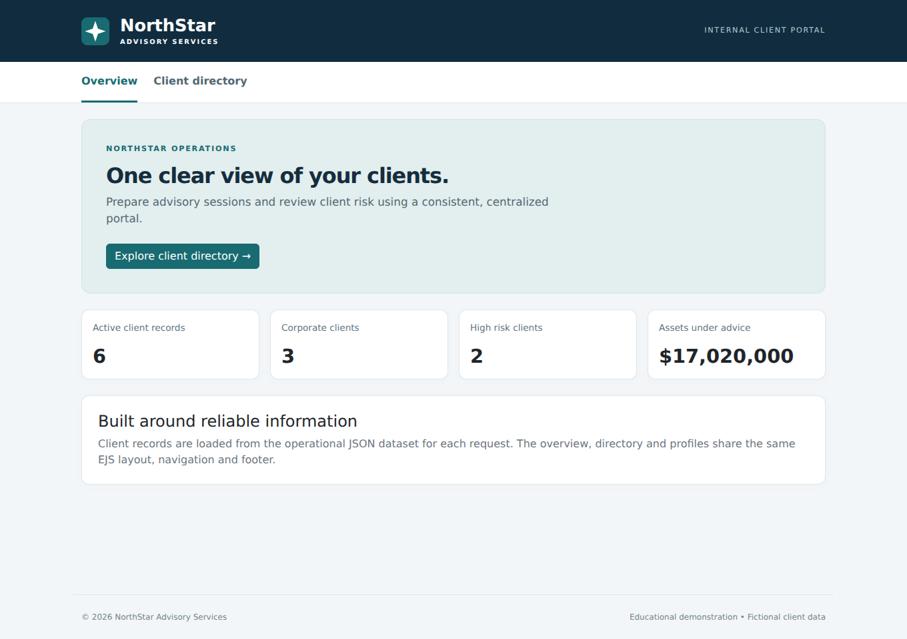
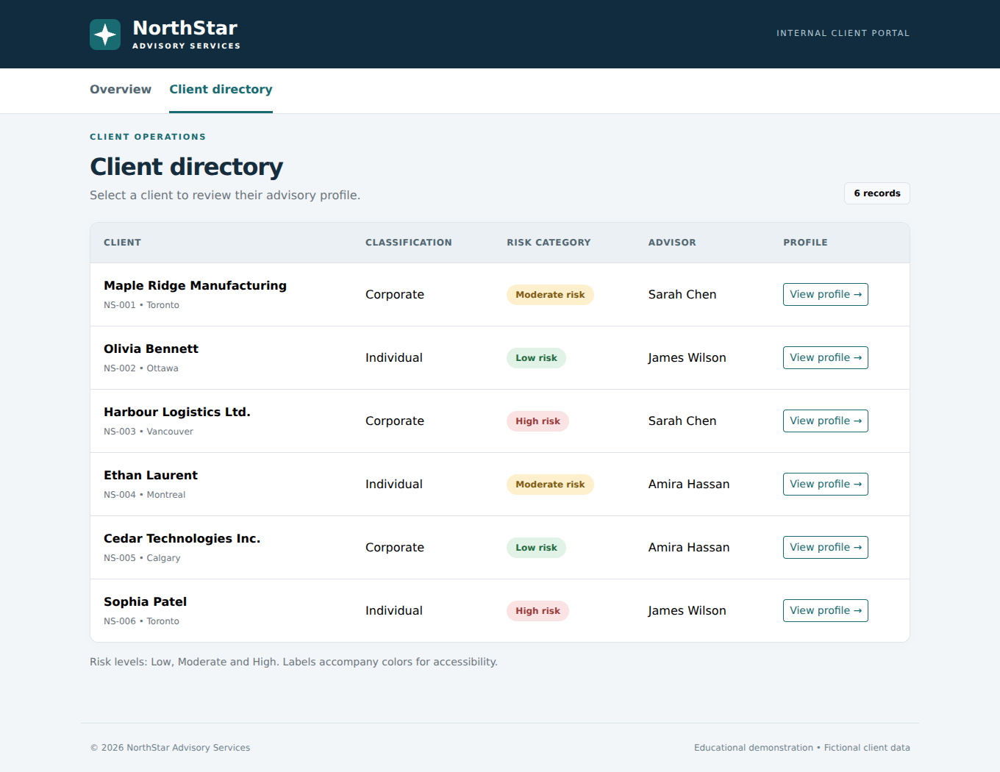
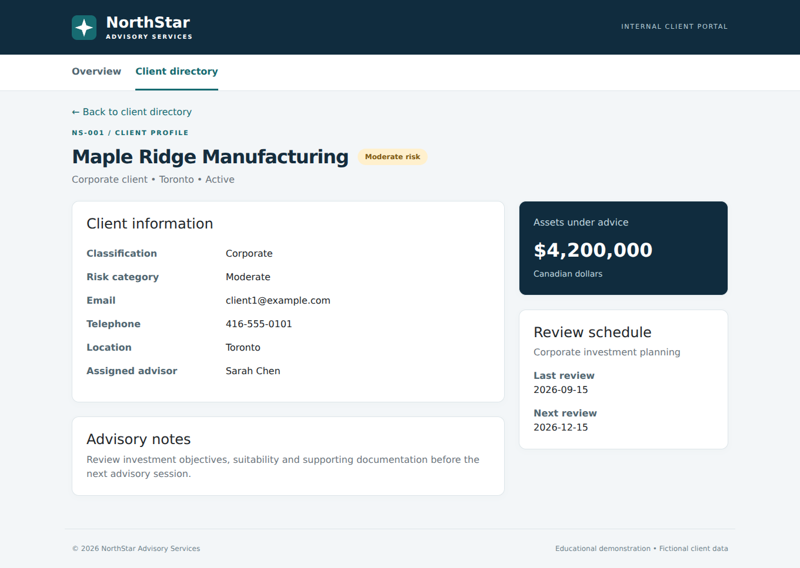

# NorthStar Advisory Services - EJS Client Portal

Dynamic View Generation Using EJS Template Engine  
Author: Deren Daniel Karabillioglu

## Project overview
A server-rendered internal client portal built with Node.js, Express, EJS, Express EJS Layouts and Bootstrap. All pages use `views/layouts/main.ejs` and shared header, navigation and footer partials. Six fictional records are rendered from `data/clients.json`; there are no hard-coded client profile pages.

## Installation
Install Node.js 20 or later, download or clone this repository, and open a terminal in the project folder:

```bash
npm ci
```

## Startup
```bash
npm start
```
Open http://localhost:3000. Set the optional `PORT` environment variable to use another port. Bootstrap is served locally from the installed dependency, so the interface needs no external CDN.

## Implemented routes
| Method | Route | Purpose |
| --- | --- | --- |
| GET | `/` | Overview and dataset-derived statistics |
| GET | `/clients` | Dynamic client directory |
| GET | `/clients/:id` | Individual client profile, e.g. `/clients/NS-001` |

Unknown clients and URLs return a styled 404 page; dataset failures return a styled 500 page. Both reuse the main layout. Static assets are hosted under `/css`, `/images` and `/vendor/bootstrap`.

## Dataset updates
Edit and save `data/clients.json`, then refresh a page. Controllers read the file on every request; no server restart or template modification is needed. Maintain the existing field structure and use unique string IDs. The overview statistics also reflect the changed dataset. Risk categories are `Low`, `Moderate` and `High`. All records and contact details are fictional.

## Structure
```text
app.js
package.json
package-lock.json
routes/clientRoutes.js
controllers/clientController.js
data/clients.json
views/layouts/main.ejs
views/partials/header.ejs
views/partials/navigation.ejs
views/partials/footer.ejs
views/partials/riskBadge.ejs
views/pages/home.ejs
views/pages/clients.ejs
views/pages/clientDetails.ejs
views/pages/error.ejs
public/css/style.css
public/images/northstar.svg
docs/screenshots/
docs/NorthStar_EJS_Lab_Report.pdf
tests/portal.test.js
```

## Screenshots
### Shared layout on the overview
Header, navigation, content and footer are injected through the shared EJS layout.


### Dynamic client list


### Dynamic client details


## Verification
```bash
npm test
```
Four integration tests verify shared layouts and local Bootstrap, dataset-driven profile links and risk labels, next-request updates with HTML escaping, and 404/500 responses. Test fixtures are restored after dataset mutation tests. Desktop screenshots are captured from the running application; the profile was also checked at a 390 px mobile viewport.

## Report and submission
[PDF lab report](docs/NorthStar_EJS_Lab_Report.pdf)

Submit only this GitHub repository link in the LMS. Source code, screenshots and the supplementary PDF belong inside the repository.
